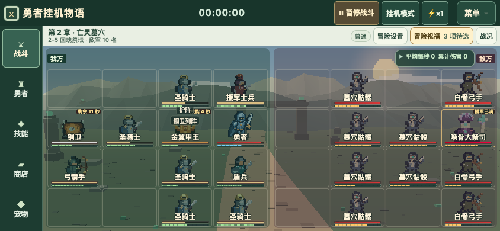

# Hero Idle RPG

**[▶ 浏览器直接开玩](https://zyh-cc.github.io/Hero-Idle-RPG/)** · [下载 v8.0.1 HTML](https://github.com/Zyh-cc/Hero-Idle-RPG/releases/latest) · [更新日志](./CHANGELOG.md)

《勇者挂机物语》是一款中文像素挂机 RPG。带着宠物和援军穿过六章像素冒险。勇者会自动出手，轮到你决定谁站前排、先打谁，以及这一轮点哪条专精。手机横屏开玩，电脑直接打开，无需账号。

- **站位会改变战斗。** 双方各有 4×4 格。勇者和召唤物优先执行战术，再攻击最近的活敌。箭雨、旋风斩和部分光环会随技能等级扩大覆盖。
- **一轮冒险有不同养成方向。** 从战士、游侠、卫士起步，搭配专精、装备和进化宠物。完成对应挑战后还能解锁四个进阶职业。
- **想主动配阵也能挂机。** 手动换位、集火和选奖励，也可预设装备、加点和补给偏好，交给挂机模式。

## 第一次怎么玩

1. 点「技能」选职业，在「宠物」领取起手伙伴。
2. 回到战场，在「我方」旁点「布阵」。可拖动勇者与召唤物虚影，再点「确认」。
3. 点「开始专注」，从哥布林营地出发。阵亡后回营整备，再挑战本章。

手机横屏的侧栏可切换勇者、技能、商店和宠物，右上菜单可打开图鉴与设置。进度保存在当前浏览器。想离线玩，从 Release 下载 HTML 后直接打开。游戏里的「新手指引」可以随时回看。

## 订阅更新与反馈

- 想收到新版本通知，在仓库页点 **Watch → Custom → Releases**。也可点 **Star** 收藏。
- 遇到卡关、显示或存档问题，欢迎提交反馈，带上职业、难度、关卡和设备即可。[提交游戏反馈](https://github.com/Zyh-cc/Hero-Idle-RPG/issues/new?template=game-feedback.yml)
- 找旧版本可按日志逐版下载，也可下载全部历史 HTML。[逐版日志](./CHANGELOG.md) · [历史版本 ZIP](https://github.com/Zyh-cc/Hero-Idle-RPG/archive/refs/heads/archive/versions.zip)

A Chinese pixel-art browser idle RPG with a 4×4 formation board, evolving pets, summons and a six-chapter campaign.
